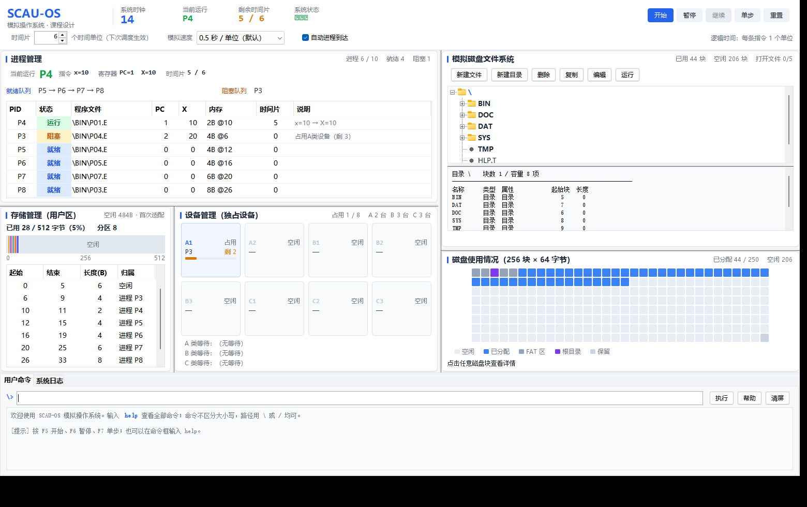

# SCAU-OS 模拟操作系统

华南农业大学《操作系统》课程设计：用 Java 在一个进程内实现一台"能真的跑起来"的小计算机。
它有自己的磁盘（一个 16 KB 的 `disk.img` 文件）、文件系统（FAT + 树形目录）、
内存（512 字节用户区）、设备（A×2、B×3、C×3）、进程（最多 10 个 PCB）、
CPU（5 类单字节指令）和命令行，以及一个 8 个区域的图形监控界面。

所有功能都是真实实现，没有假数据、没有待填的 TODO：文件真的落在磁盘镜像里，
进程真的按时间片轮转，设备真的会倒计时释放，关掉程序再打开文件还在。

---

## 1. 快速开始

### 1.1 环境

| 项目 | 要求 |
|---|---|
| JDK | 17 及以上（开发用 JDK 21，`pom.xml` 里 `maven.compiler.release=17`） |
| Maven | 3.8+（可选，也可以直接用 `javac`） |
| 图形界面 | 需要能显示窗口的桌面环境（Swing）；无界面环境下命令行与测试仍可用 |

### 1.2 编译与测试

```bash
# 方式一：Maven 正常命令（cmd / PowerShell / 已配置好的终端）
mvn clean test          # 编译 + 跑全部 88 个单元测试
mvn clean package       # 打包出 target/scau-os.jar

# 方式二：Git Bash 下请用仓库自带的包装脚本
#（Maven 自带脚本在 MINGW 下会把 /d/... 路径传给 Windows 版 java，
#  报 ClassNotFoundException: Launcher，脚本里已绕开）
./scripts/mvn.sh clean test
./scripts/mvn.sh clean package
```

测试结果应为：`Tests run: 88, Failures: 0, Errors: 0, Skipped: 0`。

### 1.3 启动图形界面

```bash
java -jar target/scau-os.jar
# 或者
mvn exec:java -Dexec.mainClass=cn.scau.os.Main
```

启动后会在工作目录下生成/打开 `disk.img`。第一次启动会自动格式化并写入默认文件树
（5 个目录、25 个文件、10 个可执行程序）。

指定工作目录（`disk.img` 放哪里）：

```bash
java -jar target/scau-os.jar D:/my-os-data
java -Dscauos.home=D:/my-os-data -jar target/scau-os.jar
```

优先级：命令行参数 > `-Dscauos.home` > 当前目录下的 `data/`。

---

## 2. 界面一览

窗口分 8 个区域，全部中文：

| 区域 | 内容 |
|---|---|
| ① 控制区 | 启动/暂停、单步、重置、时间片（1~20）、模拟速度、随机到达开关、一键创建进程 |
| ② 进程区 | 进程表（PID、状态、程序、PC、X、内存、时间片、说明）+ 就绪/阻塞/等内存/完成队列 |
| ③ 内存区 | 512 字节用户区的分区图，标出起始地址、长度、归属进程 |
| ④ 设备区 | 8 台设备的占用状态、剩余时长、等待队列 |
| ⑤ 文件区 | 目录树 + 文件内容/反汇编预览 |
| ⑥ 磁盘区 | 32×8 的 256 块网格，按 FAT/根目录/已用/空闲/保留上色，点击看块的详细信息 |
| ⑦ 命令区 | 命令行，支持全部 22 条命令，输出带颜色 |
| ⑧ 日志区 | 按级别着色的运行日志（系统/进程/内存/设备/文件/错误） |

运行中的主界面（1560×980，实际截图）：



各区域细节：

| 进程区 | 内存区 |
|---|---|
|  |  |

| 设备区 | 文件区 |
|---|---|
|  |  |

界面只读一份"系统快照"（`SystemSnapshot`），不会反向修改模型，
因此**界面刷新永远不改变业务状态**——这是本项目的核心设计约束之一。

---

## 3. 磁盘布局（重要：课程规格矛盾的说明）

课程说明里有一处**数学上不可能同时满足**的要求：

- 要求 1：FAT 每项 1 字节、共 256 项 ⇒ FAT 需要 **256 字节 = 4 个磁盘块**；
- 要求 2：第 0、1 块存放 FAT，第 2 块固定为根目录 ⇒ FAT 只有 **2 块 = 128 字节**。

128 字节装不下 256 项。本项目采用一个**可验证、可解释**的兼容布局：

```
块 0        FAT 表项   0 ~  63     （64 项，1 字节/项）
块 1        FAT 表项  64 ~ 127     （64 项）
块 2        根目录（固定，8 个目录项）
块 3        FAT 表项 128 ~ 191     （64 项）
块 4        FAT 表项 192 ~ 255     （64 项）
块 5 ~ 254  文件与子目录数据区      （250 块）
块 255      保留（避免与"255 = 链结束"标志冲突）
```

即：**保留"根目录固定在第 2 块"和"FAT 共 256 项"两条硬要求，把 FAT 拆成前 128 项 + 后 128 项两段**，
中间被根目录隔开。对上层完全透明：

- `Fat.blockOfEntry(i)` 负责"第 i 项在哪个物理块"；
- `Fat.offsetOfEntry(i)` 负责"块内偏移"；
- 上层始终把 FAT 当作一个连续的 256 项数组使用。

这一处理在 `Fat` 类的 Javadoc、`fdisk` 命令输出、`docs/FILESYSTEM.md` 第 2 节
和课程设计报告 3.2 节都有记录。答辩时被问到"为什么 FAT 占了 4 块"，
直接指着块网格界面讲这段即可。

### 3.1 FAT 的三种特殊值

| 值 | 含义 |
|---|---|
| 0 | 该块空闲 |
| 255 | 链结束（文件/目录的最后一块） |
| 254 | 系统保留块的标记（仅用于块 0、1、2、3、4、255 的表项） |

> **踩过的坑（已修）**：254 既是"保留标记"又是合法的数据块号（最后一个数据块就是 254）。
> 如果沿链遍历时用"下一块 == 254 就当保留块"来判断，写满磁盘的文件会在第 254 块被截断。
> 现在链遍历只看"下一块是否落在 5~254 的数据区范围内"，保留块一律用
> `Fat.isReservedBlock(blockNo)` 按块号判断。`FileSystemTest.chainCrossingBlock254IsNotTruncated`
> 就是这条 bug 的回归测试。

---

## 4. 目录项与文件名规则

目录项固定 **8 字节**：

| 偏移 | 长度 | 含义 |
|---|---|---|
| 0 | 3 | 文件名（大写字母/数字，不足补 0） |
| 3 | 1 | 扩展名（1 个字符，0 表示无扩展名） |
| 4 | 1 | 属性位：0x01 只读、0x02 系统、0x04 目录、0x08 可执行 |
| 5 | 1 | 起始块号 |
| 6 | 2 | 文件长度（字节） |

- 每块 64 字节 ⇒ 每块 8 个目录项。
- 根目录固定 1 块（最多 8 项），子目录可扩展（BIN 有 10 个文件 ⇒ 2 块）。
- **文件名最多 3 个字符**（课程规格），所以示例里是 `P01.E`、`HLP.T`、`RED.T`。
  写 `create \TMP\HELLO.T` 会报"文件名过长，最多 3 个字符"——这是规格限制，不是 bug。
- 删除目录项只把名称首字节置 0，不搬动其他项。

---

## 5. 可执行文件与指令集

每条指令 **1 字节**，共 5 类：

| 汇编写法 | 机器码 | 含义 |
|---|---|---|
| `x=n`（n=0~99） | n | 把 n 送入寄存器 X |
| `x++` | 100 | X 加 1（到 255 饱和） |
| `x--` | 101 | X 减 1（到 0 饱和） |
| `!A3` / `!B5` / `!C9` | 103 + 类别×10 + 时长 | 申请 A/B/C 类设备，占用"时长"个时间单位 |
| `end` | 102 | 程序结束，撤销进程 |

`!Xd` 的编码：A=0、B=1、C=2，时长 0~9 ⇒ 机器码范围 103~132。

程序以**汇编文本**编辑（`edit \BIN\P01.E`），保存时由 `InstructionCodec.assemble`
编译成字节；`type \BIN\P01.E` 显示反汇编结果。

默认 10 个程序覆盖了：纯赋值、自增自减、时间片切换（8~13 条指令）、
单设备、连续两次同设备、三类设备混合、设备竞争等场景。

---

## 6. 命令一览

在命令框输入 `help` 可看到完整说明，`help <命令>` 看单条。

| 分类 | 命令 |
|---|---|
| 浏览 | `dir [路径]`、`ls [路径]`、`type <文件>`、`ps`、`fdisk` |
| 目录 | `mkdir <目录>`、`rmdir <空目录>`、`deldir <目录（递归）>`、`chdir [目录]` |
| 文件 | `create <文件>`、`delete <文件>`、`copy <源> <目标>`、`move <源> <目标>`、`edit <文件>` |
| 属性 | `change <路径> readonly\|system\|normal\|exec` |
| 运行 | `run <可执行文件>` |
| 打开文件 | `open <文件> [w]`、`read <文件> [字节数]`、`close <文件>` |
| 系统 | `format [/y]`、`help`、`clear` |

路径用 `\` 或 `/` 都行，大小写不敏感，支持相对路径（`chdir` 之后生效）。
`format` 默认弹出二次确认，`/y` 跳过确认（脚本用）。

---

## 7. 目录结构

```
scau_os_ks/
├── pom.xml                       Maven 配置（Java 17、JUnit 5）
├── README.md                     本文件
├── scripts/mvn.sh                Git Bash 下的 Maven 包装脚本
├── docs/
│   ├── 课程设计报告.md            完整报告（需求→设计→实现→测试→总结）
│   ├── ARCHITECTURE.md           总体架构与分层、线程模型
│   ├── CLASS_GUIDE.md            逐类导读（先读哪几个文件）
│   ├── PROCESS_FLOW.md           进程生命周期与统一时钟的 7 个步骤
│   ├── FILESYSTEM.md             磁盘/FAT/目录项/文件操作细节
│   ├── MEMORY_DEVICE.md          首次适配内存管理与设备分配
│   ├── LEARNING_GUIDE.md         学习路线、动手实验、扩展练习
│   ├── TEST_REPORT.md            测试报告（88 个用例、真实缺陷记录）
│   ├── DEFENSE_QA.md             答辩问答 36 题
│   ├── TEAM_DIVISION.md          四人分工（0.4/0.2/0.2/0.2）与代码阅读任务
│   └── CODE_INDEX.md             按负责人整理的代码索引（文件:行号，自动生成）
└── src/
    ├── main/java/cn/scau/os/
    │   ├── Main.java             入口：解析工作目录、启动界面
    │   ├── fs/                   文件管理（磁盘、FAT、目录项、文件系统门面）
    │   ├── exec/                 CPU 与指令编解码
    │   ├── mem/                  存储管理（首次适配、分区表）
    │   ├── dev/                  设备管理（分配表、等待队列、倒计时）
    │   ├── proc/                 进程管理（PCB、队列、调度）
    │   ├── engine/               内核（统一时钟、快照、日志）
    │   ├── cmd/                  用户命令模块（不依赖 Swing）
    │   ├── ui/                   Swing 界面（8 个面板）
    │   └── util/                 文本对齐工具（中英文宽度）
    └── test/java/cn/scau/os/     88 个 JUnit 5 用例
```

模块规模（源码行数，不含空行统计差异）：

| 模块 | 行数 | 主要类 |
|---|---|---|
| fs 文件管理 | 2432 | `FileSystem`、`Fat`、`DirEntry`、`Disk`、`DefaultFileTree` |
| ui 界面 | 3061 | `MainFrame`、`ProcessPanel`、`FileSystemPanel`、`DiskGridPanel` |
| engine 内核 | 932 | `OperatingSystem`、`SystemSnapshot`、`EventLog` |
| cmd 命令 | 696 | `Shell` |
| proc 进程 | 681 | `ProcessManager`、`Pcb` |
| exec CPU | 594 | `Cpu`、`InstructionCodec` |
| dev 设备 | 406 | `DeviceManager`、`Device` |
| mem 存储 | 297 | `MemoryManager`、`MemoryPartition` |
| util | 91 | `TextUtil` |

合计 51 个源文件、9260 行主代码、1626 行测试代码。
其中约 700 行是**面向初学者的教学注释**（每个类的"新手阅读导航" + 关键算法的逐行说明），
说明见第 10 节与 `docs/TEAM_DIVISION.md` 第 9 节。

---

## 8. 关键设计取舍

1. **不用线程模拟 CPU 和多道程序，改用统一逻辑时钟。**
   所有状态变化都发生在 `OperatingSystem.tick()` 里，界面只用一个 `javax.swing.Timer`
   每 N 毫秒调一次。好处：状态可精确复现、可单步、可在单元测试里循环调用 `runTicks(100)`。
   如果用真实线程 + `sleep`，"两个定时器各扣一次设备倒计时"这类 bug 几乎无法避免。

2. **命令层与界面解耦。**
   `Shell` 只返回 `CommandResult`，不认识任何 Swing 类；编辑器与二次确认通过
   `EditorService`、`ConfirmService` 两个函数式接口注入。所以 22 条命令全部能在
   无界面环境下测试。

3. **界面只读快照。**
   `OperatingSystem.snapshot()` 一次性复制出全部状态（进程、内存、设备、FAT、日志），
   8 个面板各取所需。避免"进程表 3 个、内存图 4 个分区"这种不一致。

4. **错误一律抛 `FsException`，消息是中文。**
   能直接展示给用户，不需要界面层再翻译一遍。

---

## 9. 已知限制（如实说明）

| 限制 | 原因 |
|---|---|
| 文件名最多 3 字符、扩展名 1 字符 | 课程规格的 8 字节目录项 |
| 根目录最多 8 个目录项，不能扩展 | 课程规格：根目录固定占第 2 块 |
| 只支持单级文件属性，无权限位/时间戳 | 8 字节目录项放不下 |
| 可执行文件只能是单字节指令，无变量数组、无跳转 | 课程规定的 5 类指令 |
| 随机到达的进程来自 `\BIN` 下的程序，不是任意文件 | 简化演示，避免创建不可运行的文件 |
| 磁盘容量固定 16 KB，最多 5 个文件同时打开 | 课程规格 |
| 界面未做高 DPI 缩放适配 | Swing 默认行为，4K 屏可调系统缩放 |

---

## 10. 学习与答辩材料

- 想**分工讲代码**（4 人小组）：看 `docs/TEAM_DIVISION.md`——权重 0.4/0.2/0.2/0.2 的切分理由、
  每人必读的文件与行号、60 分钟演示脚本、22 条交叉提问。配套 `docs/CODE_INDEX.md` 查任意方法在第几行。
- 想**快速读懂一个类**：每个类的 Javadoc 末尾都有一段"新手阅读导航"（是什么 / 从哪读起 / 易错点 / 谁主讲）。
- 想**读懂代码**：先看 `docs/CLASS_GUIDE.md` 的"10 个入口"，按顺序读 6 个文件即可串起全流程。
- 想**讲清流程**：`docs/PROCESS_FLOW.md` 用具体时间单位逐 tick 拆解了
  "时间片切换""设备竞争""内存不足"三个场景。
- 想**准备答辩**：`docs/DEFENSE_QA.md` 有 36 个问答，含"为什么 FAT 占 4 块""为什么不用线程""如果文件大到内存装不下怎么办"。
- 想**动手改**：`docs/LEARNING_GUIDE.md` 给了 8 个由易到难的扩展练习（加指令、加设备类型、实现二级索引、加优先级调度等）。
