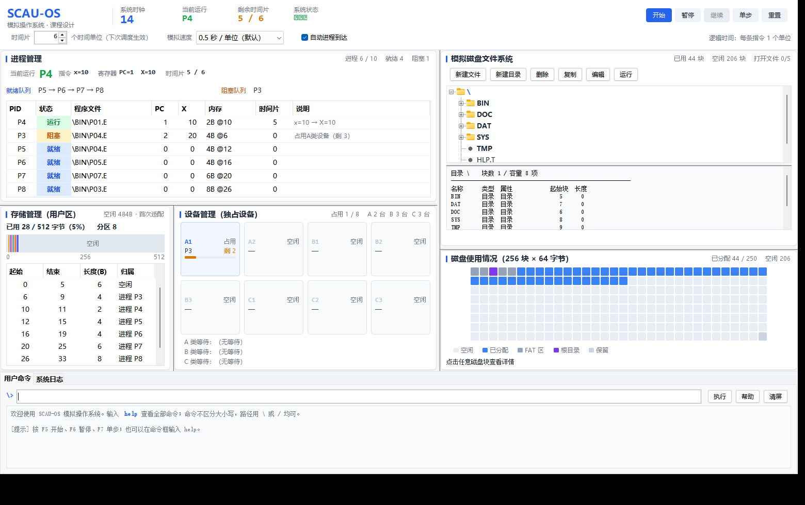

# 操作系统课程设计报告

## 基于 Java 的模拟操作系统（SCAU-OS）

| 项目 | 内容 |
|---|---|
| 课程 | 操作系统课程设计 |
| 学校 | 华南农业大学 |
| 题目 | 模拟操作系统的设计与实现 |
| 技术栈 | Java 17 / Maven / Swing / JUnit 5 |
| 代码规模 | 51 个源文件、9260 行主代码（含约 700 行教学注释）、1626 行测试代码、88 个单元测试 |
| 姓名 / 学号 / 班级 | （按实际填写） |
| 完成日期 | 2026 年 10 月 |

---

## 摘要

本设计在一个 Java 进程内实现了一台"可运行的模拟计算机"。它以 16 KB 的磁盘镜像文件
模拟磁盘，实现了 FAT 显式链接的文件系统（256 个 1 字节表项、8 字节目录项、树形目录、
绝对/相对路径、跨块读写、打开文件表）；以 512 字节用户区实现首次适配的动态分区存储管理；
以 A×2、B×3、C×3 三类独占设备实现设备分配、等待队列与倒计时释放；
以最多 10 个 PCB 实现时间片轮转的进程管理（含闲逛进程、三类中断、随机到达）；
以一个单字节指令集的 CPU 解释器真正执行可执行文件；并提供 22 条命令与
8 个区域的图形监控界面。

整个系统由**统一逻辑时钟**驱动，每次 `tick()` 按固定 7 步推进一个时间单位，
因此状态完全可复现、可单步、可单元测试。界面只读取一份状态快照，不修改模型，
从结构上保证"界面刷新不改变业务状态"。测试共 88 个用例，全部通过；
开发与测试过程中发现并修复了 7 个真实缺陷，其中"FAT 保留标记 254 与最后一个数据块号撞号
导致大文件块链被截断"是一个只有在写满磁盘时才会暴露的深层次问题。

**关键词**：模拟操作系统；FAT；首次适配；时间片轮转；逻辑时钟；单元测试

---

## 1 课题背景与目的

操作系统课程中的进程调度、存储管理、设备分配、文件系统等概念，通常以原理和算法形式讲授，
学生很难看到"它们一起工作时是什么样子"。本设计的目标不是复刻一个真实内核，
而是构建一个**规模可控、行为可观察、结论可验证**的模型：

1. 每个模块的数据结构都必须真实存在（FAT 真的在磁盘上，PCB 真的在内存里）；
2. 每个算法都必须真的起作用（时间片到了真的切换，设备用完真的唤醒）；
3. 每个状态都必须可观察（界面上的进程表、内存条、设备卡、磁盘网格）；
4. 每个行为都必须可验证（单元测试断言到 PC、X、块号这一级）。

---

## 2 需求分析

### 2.1 功能需求

| 编号 | 需求 | 验收标准 |
|---|---|---|
| F1 | 文件管理 | 磁盘 256 块 × 64 字节；FAT 256 项 × 1 字节；根目录固定第 2 块；8 字节目录项；绝对/相对路径；5 个目录、15 个以上文件；打开文件表最多 5 项；跨块读写；重启后数据仍在 |
| F2 | 存储管理 | 512 字节用户区；首次适配；分区拆分与合并；最多 10 个进程 |
| F3 | 设备管理 | A×2、B×3、C×3 独占设备；分配表；等待队列；倒计时释放；唤醒 |
| F4 | 进程管理 | 最多 10 个 PCB + 1 个闲逛进程；时间片轮转（默认 6）；程序结束/时间片/IO 三类中断；随机到达可开关 |
| F5 | CPU 解释器 | 5 类指令，每条 1 字节；`x=n`、`x++`、`x--`、`!Xd`、`end`；汇编/反汇编 |
| F6 | 用户命令 | 16 条以上命令，覆盖文件、目录、属性、运行、格式化 |
| F7 | 图形监控 | 8 个区域，中文界面，状态实时刷新 |
| F8 | 测试与文档 | 覆盖各模块的单元测试；README 与设计文档 |

### 2.2 关键约束与矛盾分析

**约束 1**：磁盘固定 256 块 × 64 字节。

**约束 2（矛盾点）**：FAT 每项 1 字节、共 256 项 ⇒ 需要 4 个块（256 字节）；
但课程又要求"第 0、1 块存放 FAT，第 2 块固定为根目录"⇒ 只有 2 个块（128 字节）。

这两条不能同时满足。若强行"FAT 只占 0、1 块"，则只能表示 128 个表项，
无法覆盖 256 个块；若"FAT 占 4 个块"，则根目录不能固定在第 2 块。

本设计的处理原则是：**优先满足"FAT 覆盖全部 256 块"和"根目录固定第 2 块"，
把 FAT 拆成两段**（块 0、1 存表项 0~127，块 3、4 存表项 128~255），
并在报告、README、`Fat` 类注释与 `fdisk` 命令输出中明确记录这一取舍。
这是一个可验证的方案：`FileSystemTest.fatLayoutIsVerifiable` 直接断言
`blockOfEntry(0)=0`、`blockOfEntry(64)=1`、`blockOfEntry(128)=3`、`blockOfEntry(255)=4`。

**约束 3**：目录项 8 字节 ⇒ 文件名 3 字符、扩展名 1 字符、长度字段 2 字节（最大 65535）。

**约束 4**：只有一个 CPU ⇒ 任何时刻最多一个进程 RUNNING，其余在就绪/阻塞队列。

---

## 3 总体设计

### 3.1 体系结构

系统分为五层，依赖方向单向：

```
ui（Swing，只读快照）
  ↓ 调用
cmd（命令解析，不依赖 Swing）
  ↓ 调用
engine（OperatingSystem：统一时钟、调度决策、中断处理）
  ↓ 调用
fs / mem / dev / proc / exec（五个硬件模块）
  ↓ 调用
Disk（RandomAccessFile → disk.img）
```

### 3.2 模块划分

| 模块 | 主要类 | 职责 |
|---|---|---|
| 文件管理 | `Disk`、`Fat`、`DirEntry`、`PathUtil`、`OpenFileTable`、`FileSystem`、`DefaultFileTree` | 块设备、FAT、目录项、路径、打开文件表、文件操作门面 |
| 存储管理 | `MemoryManager`、`MemoryPartition` | 512 字节用户区、首次适配、拆分合并 |
| 设备管理 | `DeviceType`、`Device`、`DeviceRequest`、`DeviceManager` | 8 台设备、分配表、等待队列、倒计时 |
| 进程管理 | `Pcb`、`ProcessState`、`ProcessManager` | PCB 池、4 个队列、5 个原语 |
| CPU | `Cpu`、`CpuOutcome`、`InstructionCodec` | 寄存器、取指执行、单字节编解码 |
| 内核 | `OperatingSystem`、`SystemSnapshot`、`EventLog` | 统一时钟、快照、日志 |
| 命令 | `Shell`、`CommandResult` | 22 条命令 |
| 界面 | `MainFrame` + 8 个面板 + `SimulationDriver` | 图形监控 |

### 3.3 核心设计决策

**决策 1：统一逻辑时钟代替多线程。**

所有状态变化都发生在 `OperatingSystem.tickInternal()`，界面用一个 `javax.swing.Timer`
驱动。好处：①状态可复现（固定种子）；②可单步；③可单元测试（`runTicks(n)`）；
④不存在"两个定时器各扣一次倒计时"的竞态。

**决策 2：界面只读快照。**

`snapshot()` 一次性复制全部状态为 `SystemSnapshot`，8 个面板各取所需。
保证界面一致、不可反向修改模型。

**决策 3：命令层与界面解耦。**

`Shell` 返回 `CommandResult`，编辑器与确认框通过 `EditorService` / `ConfirmService`
注入。因此 22 条命令全部可以在无界面环境下测试。

**决策 4：错误用异常表达，消息中文化。**

`FsException` / `AssemblyException` 的消息直接面向用户，命令层统一转成
`CommandResult.error("错误：...")`。

### 3.4 关键数据结构

| 结构 | 大小/数量 | 说明 |
|---|---|---|
| 磁盘块 | 64 字节 × 256 | 0、1、3、4 为 FAT；2 为根目录；5~254 数据；255 保留 |
| FAT 表项 | 1 字节 × 256 | 0 空闲、255 链结束、254 保留标记、其他为下一块号 |
| 目录项 | 8 字节 | 名称 3 + 扩展名 1 + 属性 1 + 起始块 1 + 长度 2 |
| 用户区 | 512 字节 | 首次适配分区 |
| 分区表项 | 起址 + 长度 + 归属 PID + 是否装入 | 按地址有序 |
| 设备 | 8 台 | A1、A2、B1~B3、C1~C3 |
| PCB | 10 + 1（IDLE） | PID 0 为闲逛进程 |
| 打开文件表 | 5 项 | 路径、属性、起始块、长度、读写指针、模式 |

### 3.5 接口设计（对外主要方法）

```java
// 内核
os.tick(); os.stepOnce(); os.runTicks(n);
os.startProcess("\\BIN\\P01.E");  os.killProcess(pid);
os.blockProcess(pid, reason);     os.resumeProcess(pid);
os.setQuantum(6);  os.setAutoArrival(false);  os.snapshot();

// 文件系统
fs.createFile(path, content, attr);  fs.readFile(path);  fs.writeFile(path, data);
fs.mkdir(path);  fs.rmdir(path);  fs.deldir(path);
fs.openFile(path, 'r');  fs.readOpenedFile(path, n);  fs.closeFile(path);

// 命令
CommandResult r = new Shell(os).execute("run \\BIN\\P01.E");
```

---

## 4 详细设计

### 4.1 文件系统

**磁盘布局**（见 2.2 的矛盾分析）：

```
块 0      FAT 表项 0~63
块 1      FAT 表项 64~127
块 2      根目录（8 个目录项）
块 3      FAT 表项 128~191
块 4      FAT 表项 192~255
块 5~254  数据区（250 块）
块 255    保留
```

**分配算法**：`allocateChain(n)` 从块 5 开始扫描空闲块，取到 n 个后按顺序串链，
最后一块写 255。空间不足返回 -1。

**路径解析**：`lookup(path)` 从根目录块 2 开始，按段逐级 `findEntry(name, ext)`，
返回 `(所在目录块, 槽位下标, 目录项副本)`。根目录特判，因为块 2 不在数据区。

**目录扩展**：`addEntry` 找不到空槽 → `fat.allocateChain(1)` → 接到目录链尾 → 写入。
子目录可无限扩展（受磁盘容量限制），根目录固定 8 项。

**跨块读写**：`writeNewChain` 按 `ceil(len/64)` 分配并逐块写；
`readChain` 沿链读出并按 length 截断。

**打开文件表**：5 项，记录读写指针；`writeOpenedFile` 必要时 `appendBlock` 扩链；
`closeFile` 把长度写回目录项。

**默认文件树**：5 个目录（BIN/DOC/DAT/SYS/TMP）、25 个文件（10 个可执行、13 个文本、
2 个根目录说明文件），初始占用 44 块，空闲 206 块。

### 4.2 存储管理

```java
int start = alloc(pid, size);   // 首次适配 + 拆分
free(pid);                      // 回收 + 合并相邻空闲区
```

分区表按地址有序，`allocate` 找到第一个足够大的空闲分区，切走前 size 字节，
剩余部分插到后面；`release` 置空闲后调用 `mergeFreePartitions()` 合并。
程序装入用 `loadProgram(start, code)` 把指令副本写进 `byte[512]`。

### 4.3 设备管理

```
8 台设备（A1,A2 | B1,B2,B3 | C1,C2,C3）
每类一条等待队列（FIFO）：Deque<DeviceRequest(pid, duration)>
```

- 申请：有同类空闲实例 → `assign` 并阻塞；没有 → 入队并阻塞。
- 推进：`tickDevices()` 所有占用中设备 `remaining--`，返回归零者。
- 释放：`release` → 唤醒原进程 → `handDeviceToNextWaiter` 直接交给队首。
- 撤销：`releaseAll(pid)` + `removeWaiter(pid)`。

### 4.4 进程管理

**PCB 字段**：PID、程序路径、状态、PC、X、内存起址/长度、占用设备类型、
提交时间、运行时间、时间片余量、阻塞原因、结束时间、当前指令、最近结果。

**四个队列**：就绪（FIFO）、阻塞、等内存、完成（保留最近 12 条）。
**调度**：`dispatch` 取就绪队首，`sliceRemaining = quantum`；队列空则 IDLE。
**时间片**：每执行一条指令后 `sliceRemaining--`，减到 0 触发中断 → 保存现场 → 放回队尾。

### 4.5 CPU 与指令

| 指令 | 机器码 | 执行效果 |
|---|---|---|
| `x=n` | 0~99 | X=n，PC++ |
| `x++` | 100 | X=min(255,X+1)，PC++ |
| `x--` | 101 | X=max(0,X-1)，PC++ |
| `!Xd` | 103+类×10+时长 | PC++，产生设备申请（进程随即阻塞） |
| `end` | 102 | 不推进 PC，产生结束事件 |

取指地址 = `memoryStart + pc`，从内存副本取，不从磁盘取。

### 4.6 命令与界面

命令 22 条：`help dir ls type create delete copy move mkdir rmdir deldir change chdir
edit run format fdisk open close read ps clear`（见附录 A）。

界面 8 区：控制、进程、内存、设备、文件、磁盘、命令、日志。
`SimulationDriver` 是唯一的定时器；`MainFrame.refresh()` 生成快照并分发。

---

## 5 实现要点

### 5.1 一个 tick 的完整实现（节选）

```java
private void tickInternal() {
    clock++;                      // ①
    handleDeviceCountdown();      // ② 倒计时 + I/O 中断 + 交给队首
    if (processes.getRunning() == null) dispatchNext();          // ③
    Pcb running = processes.getRunning();
    if (running != null && running.isIdle() && processes.hasReadyProcess()) {
        processes.preemptRunning(); dispatchNext(); running = processes.getRunning();
    }
    if (running != null && !running.isIdle()) {
        executeOneInstruction(running);                          // ④
        if (processes.getRunning() == running) {                 // ⑤
            running.addRunTime();
            int left = running.getSliceRemaining() - 1;
            running.setSliceRemaining(Math.max(0, left));
            if (left <= 0) handleTimeSliceInterrupt();
        }
    } else if (running != null) {
        running.addRunTime();
    }
    processes.retryPendingProcesses();                            // ⑥
    handleRandomArrival();                                        // ⑦
}
```

### 5.2 磁盘镜像读写

```java
public synchronized byte[] readBlock(int blockNo) {
    checkBlockNo(blockNo);
    byte[] buffer = new byte[BLOCK_SIZE];
    file.seek((long) blockNo * BLOCK_SIZE);
    file.readFully(buffer);
    return buffer;
}
```

一次文件操作涉及：读目录块 → 读 FAT 块 → 读多个数据块。
全部通过 `RandomAccessFile.seek` 定位，不把整个镜像读进内存。

### 5.3 界面刷新

```java
private void refresh() {
    SystemSnapshot s = os.snapshot();
    processPanel.refresh(s);
    memoryPanel.refresh(s);
    devicePanel.refresh(s);
    filePanel.refresh(s);
    diskGridPanel.refresh(s);
    logPanel.refresh(s);
    controlPanel.refresh(s);
}
```

`refresh` 不读取模型、不做业务判断，只把快照画出来。

---

## 6 测试

### 6.1 测试概况

| 测试类 | 用例数 | 结果 |
|---|---|---|
| FileSystemTest | 22 | 全通过 |
| MemoryManagerTest | 12 | 全通过 |
| DeviceManagerTest | 11 | 全通过 |
| InstructionCodecTest | 10 | 全通过 |
| ProcessSchedulingTest | 13 | 全通过 |
| ShellTest | 13 | 全通过 |
| IntegratedScenarioTest | 7 | 全通过 |
| 合计 | **88** | **0 失败 0 错误** |

执行：`./scripts/mvn.sh test` → `BUILD SUCCESS`，耗时约 6 秒。
详细清单与需求覆盖对照见 `docs/TEST_REPORT.md`。

### 6.2 典型用例的解释

**时间片与现场恢复**：时间片设为 3，两个 8 指令程序交替执行。
第 7 个时间单位时，第一个进程应"从 PC=3、X=3 继续"，执行 `x++` 后 X=4。
这条断言同时验证了 PC 与 X 的保存和恢复。

**跨块文件**：`\DOC\N01.T` 为 294 字节 ⇒ 5 块；断言 `chainOf().size()==5`、
读回内容首尾一致、块数收支平衡。

**设备竞争**：3 个进程同时申请 A 类设备（时长 9），第 3 个必须进入等待队列；
60 个时间单位后三者在 `finished` 里，设备与内存全部归还。

**持久化**：关闭系统 → 用同一目录重新构造 `OperatingSystem` → 文件内容、
子目录、`\BIN` 下 10 个程序全部还在。

---

## 7 运行效果

启动后的实际输出（命令区，节选）：

```
> dir
目录 \    块数 1 / 容量 8 项 / 已用 7 项
名称        类型  属性              起始块    长度    块数
----------------------------------------------------------
BIN         目录  目录                   5       0       2
DAT         目录  目录                   7       0       1
DOC         目录  目录                   6       0       1
SYS         目录  目录                   8       0       1
TMP         目录  目录                   9       0       1
HLP.T       文件  可读写                43     165       3
RED.T       文件  可读写                46     175       3
----------------------------------------------------------
共 7 项；磁盘剩余 206 块

> fdisk
================ 模拟磁盘参数 ================
  块大小      64 字节
  块总数      256
  总容量      16384 字节
  FAT 表项    256 项 × 1 字节 = 4 块
  磁盘布局    块 0、1 → FAT 前 128 项
              块 2   → 根目录（8 个目录项）
              块 3、4 → FAT 后 128 项
              块 5~254 → 文件与子目录数据
              块 255 → 保留
  数据块      250 块
  已分配      44 块
  空闲        206 块
  已打开文件  0 / 5
```

`run \BIN\P03.E` 之后的日志（节选）：

```
[0001] 进程   调度：P1 占用 CPU（PC=0，时间片 6）
[0001] 进程   P1 执行 x=1，X=1
...
[0006] 进程   时间片中断：P1 用完 6 个时间单位，保存现场 PC=6 X=6，重新调度
[0007] 进程   P1 执行 x++，X=7
[0008] 进程   程序结束中断：P1 执行 end，最终 X=7，撤销进程并回收资源
```

界面效果：进程表随 tick 更新 PC/X/时间片；内存条按分区着色并显示"起址-长度-PID"；
设备卡片显示"占用中 / 剩余 3"与等待队列；磁盘网格 256 格按 FAT/根目录/已用/空闲/保留
五种颜色显示，点击某格显示 `块 154  FAT=155  已分配  \DOC\N01.T  下一块 → 155`。



| 进程区 | 内存区 |
|---|---|
|  |  |

| 设备区 | 文件区 |
|---|---|
|  |  |

---

## 8 开发中遇到的问题与解决

| # | 问题 | 原因 | 解决 |
|---|---|---|---|
| 1 | 写满磁盘时 `IndexOutOfBoundsException: Index 205/205` | FAT 保留标记 254 与最后一个数据块号撞号，链被截断 | 链遍历只看数据区范围，保留块按块号判断；新增回归测试 |
| 2 | 首次启动报"根目录已满" | 根目录块 2 不在数据区，`chainOf(2)` 返回空链 | `directoryChain()` 对根目录特判 |
| 3 | 格式化后空闲块多出 5 块 | `Fat.reset()` 未标记保留块 | 统一按 `RESERVED_BLOCKS` 写入 |
| 4 | 默认文件树安装失败：文件名过长 | 使用了 `HELP.T`、`READ.T` | 改为 `HLP.T`、`RED.T` |
| 5 | 目录列表扩展名显示小写 | `getFullName()` 直接拼存储值 | 显示时转大写 |
| 6 | 中文显示成方块 | Consolas 无中文字形 | 增加 `CONSOLE_FONT_NAME` 并用 `canDisplayUpTo` 检测 |
| 7 | Git Bash 下 `mvn` 启动失败 | Maven 脚本把 Unix 路径传给 Windows java | 提供 `scripts/mvn.sh` 包装脚本 |

第 1 个问题最值得记录：它是一个"数据格式的表示能力"问题——
1 字节的空间里既要放 256 个块号、又要放特殊标记，标记必然和某个块号冲突。
正确做法是让"保留块"成为**块号的性质**，而不是**表项值的特殊取值**。

---

## 9 总结与展望

### 9.1 完成情况

| 需求 | 完成度 |
|---|---|
| 文件管理（含 FAT、目录、跨块、打开文件表、持久化） | 全部完成，22 个用例 |
| 存储管理（首次适配、拆分合并、等内存） | 全部完成，12 个用例 |
| 设备管理（独占、等待队列、倒计时、唤醒） | 全部完成，11 个用例 |
| 进程管理（PCB、轮转、三类中断、闲逛、随机到达） | 全部完成，13 个用例 |
| CPU 解释器（5 类指令、汇编/反汇编） | 全部完成，10 个用例 |
| 命令模块（22 条） | 全部完成，13 个用例 |
| 图形监控（8 区、中文） | 全部完成，手工验证 8 项清单 |
| 测试与文档 | 88 个用例 + README + 8 份文档 |

### 9.2 收获

1. **数据结构决定能力上限**。8 字节目录项直接决定了文件名 3 字符、最大文件 64 KB；
   1 字节 FAT 决定了标记值必然与块号冲突。设计数据结构时必须先想清楚"以后要放什么"。
2. **可测试性来自架构**。把时钟抽成 `tick()`、把命令抽成 `Shell` 之后，
   88 个用例全部不需要界面，这在"只有 Swing 界面"的写法里是不可想象的。
3. **顺序即语义**。7 步时钟的顺序不是随意的，改一处就会让"设备少扣一次"或"进程多等一轮"。
4. **文档要写"为什么"**。规格矛盾、254 号块、为什么不用线程——这些"为什么"比"是什么"更有价值。

### 9.3 可扩展方向

- 调度：优先级、多级反馈队列、老化防饥饿；
- 内存：分页 + 页面置换（LRU/Clock），演示虚拟内存；
- 文件：索引分配、目录哈希、权限位；
- 并发：信号量/PV 原语，在单 CPU 逻辑时钟下模拟互斥与同步；
- 工程：镜像加魔数与版本号、界面自动化冒烟测试。

---

## 10 参考文献

1. 汤小丹，梁红兵，哲凤屏，汤子瀛. 计算机操作系统（第四版）. 西安：西安电子科技大学出版社，2014.
2. Silberschatz A, Galvin P B, Gagne G. Operating System Concepts (10th ed.). Wiley, 2018.
3. Oracle. Java Platform SE 17 API Specification：`java.io.RandomAccessFile`、`javax.swing.Timer`.
4. JUnit Team. JUnit 5 User Guide, 2024.
5. Apache Maven Project. Maven – Introduction, 2024.

---

## 附录 A 命令一览

| 命令 | 用法 | 说明 |
|---|---|---|
| `help` | `help [命令]` | 全部命令或单条说明 |
| `dir` | `dir [路径]` | 列目录（名称/类型/属性/起始块/长度/块数） |
| `ls` | `ls [路径]` | 目录则列目录，文件则显示内容 |
| `type` | `type <文件>` | 文本显示内容；可执行文件显示反汇编 |
| `create` | `create <文件>` | 创建空文件 |
| `delete` | `delete <文件>` | 删除文件（被打开或只读时拒绝） |
| `copy` | `copy <源> <目标>` | 复制；目标是目录时沿用源名 |
| `move` | `move <源> <目标>` | 移动/改名 |
| `mkdir` | `mkdir <目录>` | 创建目录 |
| `rmdir` | `rmdir <目录>` | 删除空目录 |
| `deldir` | `deldir <目录>` | 递归删除 |
| `change` | `change <路径> <属性>` | readonly/system/normal/exec |
| `chdir` | `chdir [目录]` | 切换当前目录 |
| `edit` | `edit <文件>` | 打开编辑器（.e 用汇编） |
| `run` | `run <可执行文件>` | 创建进程 |
| `format` | `format [/y]` | 格式化（需确认） |
| `fdisk` | `fdisk` | 磁盘参数与块使用 |
| `open` | `open <文件> [w]` | 打开文件（最多 5 个） |
| `close` | `close <文件>` | 关闭文件 |
| `read` | `read <文件> [字节数]` | 从读指针读取 |
| `ps` | `ps` | 进程表 |
| `clear` | `clear` | 清屏 |

## 附录 B 指令集

| 汇编 | 机器码 | 说明 |
|---|---|---|
| `x=n` | 0~99 | 赋值 |
| `x++` | 100 | 自增（255 饱和） |
| `x--` | 101 | 自减（0 饱和） |
| `!A3` / `!B5` / `!C9` | 103~132 | 申请设备，时长为最后一位数字 |
| `end` | 102 | 结束 |

## 附录 C 默认文件树

```
\
├─ BIN\   P01.E P02.E P03.E P04.E P05.E P06.E P07.E P08.E P09.E P10.E
├─ DOC\   N01.T ~ N07.T（N01 294 字节/5 块，N06 只读）
├─ DAT\   A01.T A02.T A03.T
├─ SYS\   SYS.T CFG.T(只读) LOG.T
├─ TMP\   （空）
├─ HLP.T
└─ RED.T
```

## 附录 D 源码与文档位置

```
D:/code/scau_os_ks/
├── README.md
├── pom.xml
├── scripts/mvn.sh
├── docs/（本报告与 7 份专题文档）
└── src/main/java/cn/scau/os/（51 个源文件）
```
